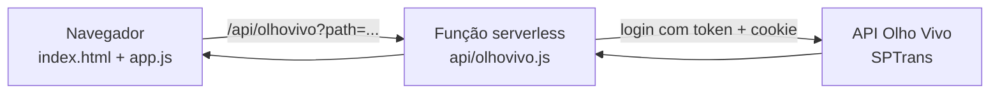

# 🚌 Meu Ponto

Painel web com os **próximos ônibus de qualquer ponto de São Paulo**, em tempo real, usando a API **Olho Vivo** da SPTrans.

> Projeto da **Global Solution 2026.2** – Application Development (FIAP, Ciência da Computação, 2º ano).
> Desafio: *Citizen Intelligence & Predictive Analytics* – monitoramento da cidade para melhorar a qualidade de vida do cidadão.

🔗 **Aplicação:** https://SEU-LINK.vercel.app  <!-- troque pelo link do Vercel -->

---

## Problema e finalidade

Quem anda de ônibus em São Paulo muitas vezes espera sem saber se o ônibus está perto ou vai demorar, e quem precisa de veículo acessível não sabe se o próximo atende. O **Meu Ponto** mostra, em poucos toques, quanto falta para cada ônibus chegar ao seu ponto, quais veículos são acessíveis e onde eles estão no mapa.

**Para quem serve:** passageiros do dia a dia, pessoas com deficiência ou mobilidade reduzida (cadeirantes, idosos) e pessoas com baixa visão.

## Funcionalidades

- 🔎 **Busca de pontos** por nome ou endereço.
- ⏱️ **Painel de próximos ônibus** em minutos, ordenado por chegada, com atualização automática a cada 30 segundos.
- ♿ **Mobilidade acessível:** selo nos veículos acessíveis e filtro "só veículos acessíveis".
- 🗺️ **Mapa** (Leaflet + OpenStreetMap) com o ponto e a posição dos ônibus previstos.
- ⭐ **Favoritos** salvos no navegador para voltar rápido ao ponto de sempre.
- 🌗 **Alto contraste e fonte grande**, com a preferência lembrada.
- 📱 **Responsivo:** layout pensado para o celular.

## Tecnologias

HTML, CSS e JavaScript puros (sem framework) · [Leaflet](https://leafletjs.com/) · função serverless Node.js no [Vercel](https://vercel.com/) · [API Olho Vivo v2.1](https://www.sptrans.com.br/desenvolvedores/) (SPTrans).

## Como funciona

A API Olho Vivo exige login com cookie de sessão e não aceita chamadas diretas do navegador (CORS). Por isso o front-end conversa com uma função serverless, que autentica com o token e repassa a consulta.



**Vantagens dessa arquitetura:** o token fica em variável de ambiente (nunca no código público), a função só aceita endpoints de uma lista permitida e a sessão é renovada automaticamente quando expira.

### Endpoints da API usados

| Endpoint | Uso no app |
|---|---|
| `GET /Parada/Buscar?termosBusca=` | Busca de pontos por nome ou endereço |
| `GET /Previsao/Parada?codigoParada=` | Previsão de chegada de todas as linhas no ponto |

## Estrutura do projeto

```
meu-ponto/
├── index.html          # estrutura da página
├── style.css           # estilos, responsividade e modo de alto contraste
├── app.js              # busca, previsões, mapa, favoritos e acessibilidade
├── api/
│   └── olhovivo.js     # função serverless: login e repasse das consultas
├── vercel.json         # fixa a função na região de São Paulo (gru1)
├── PARTICIPANTES.txt   # integrantes e divisão do trabalho
└── README.md
```

## Como executar

**Pré-requisitos:** Node.js e uma conta no GitHub e no Vercel.

1. Gere seu token em **Meus Aplicativos** na [área de desenvolvedores da SPTrans](https://www.sptrans.com.br/desenvolvedores/).
2. Clone o repositório:
   ```bash
   git clone https://github.com/gustavofranzoti/meu-ponto.git
   cd meu-ponto
   ```
3. Crie um arquivo `.env` na raiz com o token (sem aspas e sem espaços):
   ```
   OLHOVIVO_TOKEN=seu_token
   ```
4. Rode com a CLI do Vercel e abra `http://localhost:3000`:
   ```bash
   npm i -g vercel
   vercel dev
   ```
   > No Windows, se aparecer `EPERM: operation not permitted, symlink`, ative o **Modo Desenvolvedor** do Windows ou rode o terminal como administrador.

## Deploy no Vercel

1. Suba o repositório no GitHub e, no Vercel, use **Add New → Project** para importá-lo.
2. Em **Environment Variables**, crie `OLHOVIVO_TOKEN` com o seu token **antes** do deploy.
3. Clique em **Deploy**. Se a variável for criada depois, faça um **Redeploy**.

## Limitações conhecidas

- A previsão depende dos dados enviados pelos ônibus; fora do horário de operação ou em pontos de pouco movimento pode não haver veículos previstos.
- Favoritos e preferência de contraste ficam salvos no navegador do aparelho, não em uma conta.

## Possíveis melhorias

- "Ponto mais perto de mim" com a geolocalização do celular.
- Aviso "hora de sair" quando o ônibus estiver a X minutos do ponto.
- Posição em tempo real de todos os ônibus de uma linha.

## Equipe

| Integrante | RM | Contribuição |
|---|---|---|
| Gustavo Franzoti Gonçalves | 566983 | Função serverless, autenticação, deploy, busca e painel de previsões |
| Maykon Santana Fonseca | 567041 | Interface, responsividade, alto contraste, mapa, favoritos e README |

## Créditos

Dados de ônibus: **SPTrans – API Olho Vivo**. Mapa: © colaboradores do [OpenStreetMap](https://www.openstreetmap.org/copyright), biblioteca [Leaflet](https://leafletjs.com/).
